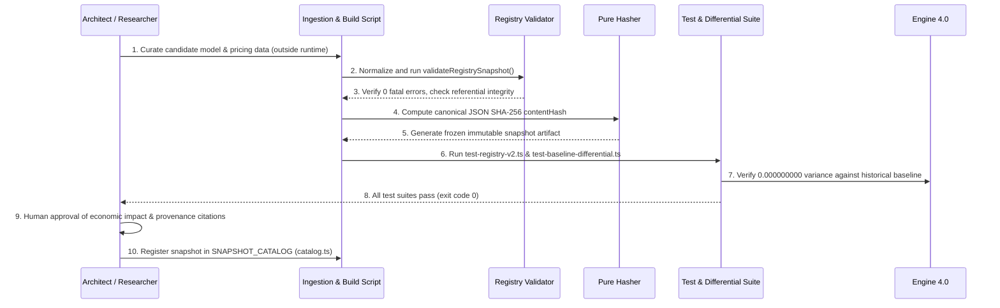

# ComputeCanvas — Module 2 Phase 3: Model Catalog Expansion & Historical Snapshot Strategy
## Read-Only Repository Audit, Data Research, Architecture Design & Implementation Blueprint (Corrected)

**Document Version:** 1.1.0 (Corrected Post-Audit Gate)  
**Status:** Architecture Design & Implementation Blueprint (Read-Only)  
**Author:** Principal AI Infrastructure Architect & Lead Systems Engineer  
**Prerequisite:** Module 2 Phase 2 Independent Verification Gate (VERDICT: PASS)  
**Target Repository:** `Winter_Seasons/computecanvas`  
**Date:** October 2026  

---

## 1. Executive Summary

ComputeCanvas is evolving into a pre-deployment AI architecture decision workbench that evaluates costs, latency percentiles, throughput (RPS), saturation, and calculation traces before code is written or cloud infrastructure is provisioned.

Following the independent verification gate of Module 2 Phase 2 and a rigorous lifecycle audit against October 2026 official provider documentation, this document establishes the corrected blueprint for **Module 2 Phase 3: Model Catalog Expansion & Historical Snapshot Strategy**.

### Key Determinations & Corrected Findings
1. **Engine Invariance Preserved:** Engine 4.0's mathematical formulas for cost, latency, throughput, and capacity utilization remain frozen. The registry serves as an explicit, validated data layer that feeds the engine via `EnginePricingBundle` without modifying computational invariants.
2. **Canonical Baseline Snapshot ID Corrected:** Inspection of `lib/registry/snapshots/baseline.ts` line 499 proves that the canonical baseline snapshot identifier is strictly:
   ```
   snap-cc-d0d6efbb12224097
   ```
   (composed of `snap-cc-` concatenated with the first 16 characters of `BASELINE_CONTENT_HASH`). Previous draft references to `snap-cc-2026-03-baseline-d0d6efbb12224097` conflated `metadata.label` (`'2026-03-baseline'`) with `metadata.snapshotId`.
3. **Model Lifecycle Audit & Corrections:**
   - `o3-mini` (OpenAI): Deprecated and scheduled for complete API retirement/shutdown on **October 23, 2026**. It cannot be classified as an active foundation for an October 2026 production snapshot. Classified as **HISTORICAL ONLY / SUNSETTING**.
   - `claude-3.5-haiku` (Anthropic): Fully retired and discontinued on core Anthropic APIs as of **February 19, 2026**. Succeeded by `claude-haiku-5-5`. Classified as **HISTORICAL ONLY / RETIRED**.
   - `gemini-2.0-flash-lite` (Google): Fully retired/EOL on `ai.google.dev` as of **June 1, 2026**. Classified as **HISTORICAL ONLY / RETIRED**.
   - Active, verified candidates for immediate October 2026 expansion are: `deepseek-chat` (V3), `deepseek-reasoner` (R1), `llama-3.3-70b-instruct` (Meta / Together AI), `mistral-large-2411` (Mistral AI), and `claude-haiku-5-5` (Anthropic).
4. **Schema Discipline:** `ModelRecord.category` in `lib/registry/types.ts` is strictly typed as `'fast' | 'frontier'`. Proposing `'reasoning'` as a category without a schema migration causes TypeScript compilation failure. In Phase 3, reasoning models are categorized structurally as `'frontier'` (or `'fast'`), while their reasoning nature is captured in `capabilityTier: 'Frontier Reasoning'`.
5. **Latency & Quality Evidence Hierarchy:** Latencies and quality scores are **not** provider-published facts (providers only publish token pricing). They are derived from independent benchmark suites (Artificial Analysis / LMSYS Arena) or documented engineering estimates, and must be explicitly distinguished from provider-published pricing facts.
6. **Historical Snapshot Governance:** A strict multi-snapshot model is enforced:
   - Canonical baseline: `snap-cc-d0d6efbb12224097` (`2026-03-baseline`, 6 models)
   - Expanded snapshot: `snap-cc-2026-10-<hash>` (`2026-10-expanded`, 11 models)
   Snapshot resolution maintains zero silent fallback: unknown snapshots and unpriced models fail explicitly with machine-readable diagnostics.

---

## 2. Actual Repository State

An independent inspection of the workspace established the following file structure and implementation boundaries:

### 2.1 File Map & Active Interfaces
- `lib/registry/types.ts`: Strongly typed domain definitions for `ModelRecord`, `PricingRecordV2`, `InfrastructureRecord`, `AssumptionRecord`, `SnapshotMetadata`, `RegistrySnapshot`, and `ValidationResult`.
- `lib/registry/hasher.ts`: Zero-dependency, pure TypeScript implementation of NIST FIPS 180-4 SHA-256 (`sha256Pure`), recursive key-sorted JSON canonicalization (`canonicalizeJson`), and recursive object freezing (`deepFreeze`).
- `lib/registry/validator.ts`: Comprehensive schema validator enforcing 14 structural and business rules, including referential integrity, non-negative tariffs, date validity, and positive context limits.
- `lib/registry/catalog.ts`: Registry snapshot directory storing `SNAPSHOT_CATALOG`, exporting `getSnapshot(identifierOrAlias)` and `getAllSnapshots()`.
- `lib/registry/adapter.ts`: Engine 4.0 adapter boundary converting immutable snapshots into `EnginePricingBundle`. Provides `resolveRegistryPricing()`, `validateArchitectureModels()`, and typed error classes `UnknownSnapshotError` and `UnpricedModelError`.
- `lib/registry/snapshots/baseline.ts`: Frozen canonical snapshot `BASELINE_SNAPSHOT` containing 6 models, 6 pricing records, 4 infrastructure components, and 16 assumptions.
- `lib/simulation/engine/index.ts`: Canonical simulation pipeline executing `simulate(workload, architecture)` with snapshot resolution and architecture model validation.
- `lib/simulation/engine/cost.ts`: Decoupled cost engine accepting optional `EnginePricingBundle`.
- `lib/simulation/engine/latency.ts`: Path-based latency engine calculating P50/P90/P95/P99 from ingress, cache, router, vector DB, and `weightedModelLatency`.
- `lib/simulation/engine/capacity.ts`: Standard 5M monthly requests cluster capacity model.
- `lib/simulation/engine/throughput.ts`: Modeled throughput based on 30-day month (2,592,000s).

### 2.2 Working Tree Status
- **Modified Tracked Files:** `lib/simulation/engine/cost.ts`, `lib/simulation/engine/index.ts`.
- **Untracked Additions:** `docs/`, `lib/registry/`, `scripts/test-registry-v2.ts`, `scripts/test-sha256-vectors.ts`, `scripts/test-baseline-differential.ts`.
- **Git Branch:** `main` (clean working tree aside from approved Phase 1 & 2 additions; no commits or pushes staged).

---

## 3. Existing Registry Architecture

```mermaid
graph TD
    subgraph Registry Data Layer
        SNAPS[Registry Snapshots<br/>baseline.ts / future snapshots] --> CAT[Snapshot Catalog<br/>catalog.ts]
        CAT --> ADAPT[Engine Adapter<br/>adapter.ts]
        HASH[Hasher & Canonicalizer<br/>hasher.ts] -.-> SNAPS
        VAL[Validator<br/>validator.ts] -.-> SNAPS
    end

    subgraph Simulation Pipeline (Engine 4.0)
        REQ[simulate(workload, arch)] --> RESOLV[resolveRegistryPricing(snapshotId)]
        ADAPT --> RESOLV
        RESOLV -->|Valid Bundle| VMOD[validateArchitectureModels(arch, bundle)]
        RESOLV -->|Unknown Snapshot| FAIL[Return Explicit Failure<br/>isValid=false, monthlyCost=0]
        VMOD -->|Valid Models| GRAPH[resolveGraph]
        VMOD -->|Unknown Model| ERR[Flag Validation Error<br/>isValid=false]
        GRAPH --> TRAF[propagateTraffic]
        TRAF --> COST[calculateCosts(workload, graph, traffic, bundle)]
        COST --> LAT[calculateLatency(graph, cacheRate, weightedModelLatency)]
        LAT --> CAP[calculateCapacity]
        CAP --> BOT[analyzeBottleneck]
        BOT --> TRACE[generateCalculationTrace]
        TRACE --> RES[SimulationResult]
    end
```

### Architectural Key Characteristics
- **Strict Decoupling:** The simulation engine does not hardcode provider pricing. All rates enter via `EnginePricingBundle`.
- **Zero Runtime I/O:** Snapshot resolution is entirely synchronous and in-memory from compiled TypeScript snapshot objects. No network requests, API keys, or database queries are introduced into simulation.
- **Fail-Safe Validation:** Missing snapshots or unrecognized model IDs immediately trip `isValid = false` with explanatory diagnostics, preventing invalid runs from being mistaken for zero-cost architectures.

---

## 4. Findings vs. Previously Reported Phase 2 Status

| Item | Reported Status | Actual Inspected Status | Discrepancy / Assessment |
|---|---|---|---|
| Registry Files | 7 files in `lib/registry/` | 7 files present + `snapshots/` dir | **Verified in repository.** Exact match. |
| Test Suites | `test-registry-v2.ts`, `test-sha256-vectors.ts`, `test-baseline-differential.ts` | All 3 scripts present and passing (121 + 13 + 15 tests) | **Verified in repository.** Exact match. |
| Baseline Models | 6 models (3 fast, 3 frontier) | Exactly 6 models in `BASELINE_MODELS` | **Verified in repository.** Exact match. |
| Infrastructure Components | 4 components (Vector DB, Cache, Gateway, Router) | Exactly 4 records in `BASELINE_INFRASTRUCTURE` | **Verified in repository.** Exact match. |
| Baseline Assumptions | 16 codified assumptions | Exactly 16 records in `BASELINE_ASSUMPTIONS` | **Verified in repository.** Matches `ASSUMPTION_REGISTRY`. |
| Content Hash | Starts with `d0d6efbb12224097` | Full 64-char hash: `d0d6efbb122240976572e3895e6f3ebc696e5114170940733d7b27fae7fa3eb5` | **Verified in repository.** Exact match. |
| Baseline Snapshot ID | Inconsistently reported as `snap-cc-2026-03-baseline-d0d6efbb12224097` | Strictly generated as `snap-cc-d0d6efbb12224097` in `baseline.ts` line 499 | **Discrepancy Corrected.** The canonical ID is 24 characters (`snap-cc-` + 16-hex slice). |
| Browser Bundle Isolation | Pure TypeScript FIPS 180-4 SHA-256 | `lib/registry/hasher.ts` has zero imports from `'crypto'` or Node built-ins | **Verified in repository.** Production build verified clean (19/19 routes). |

---

## 5. Current Model & Pricing Coverage

The baseline snapshot (`snap-cc-d0d6efbb12224097`) covers the following 6 models:

| Model ID | Provider | Category | Context Window | Baseline Latency (P95) | Input $/1M | Output $/1M | Quality Score | Status |
|---|---|---|---|---|---|---|---|---|
| `gpt-4o-mini` | OpenAI | Fast | 128,000 | 140 ms | $0.15 | $0.60 | 82 | ACTIVE |
| `gemini-2.0-flash` | Google | Fast | 1,048,576 | 90 ms | $0.10 | $0.40 | 80 | ACTIVE |
| `claude-3-haiku` | Anthropic | Fast | 200,000 | 120 ms | $0.25 | $1.25 | 78 | ACTIVE |
| `gpt-4o` | OpenAI | Frontier | 128,000 | 380 ms | $2.50 | $10.00 | 95 | ACTIVE |
| `claude-3.5-sonnet` | Anthropic | Frontier | 200,000 | 420 ms | $3.00 | $15.00 | 96 | ACTIVE |
| `gemini-2.5-pro` | Google | Frontier | 2,097,152 | 350 ms | $1.25 | $10.00 | 94 | ACTIVE |

### Coverage Gaps Identified:
1. **Zero Open-Weight Foundation Models:** No Llama, DeepSeek, or Mistral models are present.
2. **Zero Extended-Reasoning Models:** No DeepSeek R1 or dedicated chain-of-thought architectures are modeled.
3. **Outdated Fast Utility Representation:** `claude-3-haiku` is retained for historical baseline compatibility, but lacks representation of contemporary high-efficiency Anthropic generations.
4. **No European Cloud Sovereign Coverage:** Mistral AI is absent.

---

## 6. Candidate-Selection Methodology

To prevent speculative or transient model additions, candidate models are evaluated using a weighted 100-point scoring framework:

### 6.1 Evaluation Criteria & Weighting

| Criterion | Weight | Rationale |
|---|:---:|---|
| **Architecture Decision Value** | 25% | Does the model unlock practical trade-off evaluations (e.g., speed vs. depth, hosted vs. open-weight, frontier reasoning vs. fast triage)? |
| **Data Verifiability & Provenance** | 20% | Is standard per-token pricing publicly published on an official provider documentation page with clear effective dates? |
| **Engine 4.0 Compatibility** | 20% | Can the model be simulated using standard input/output token pricing and P95 latency without requiring formula changes? |
| **Provider Diversity** | 15% | Does the addition expand beyond OpenAI/Google/Anthropic to include open-weight hosts (Together AI, DeepSeek, Mistral)? |
| **Benchmark & Quality Grounding** | 10% | Are reputable public benchmark ratings available (LMSYS Arena, Artificial Analysis) to populate `qualityScore`? |
| **Lifecycle & Availability Stability** | 10% | Is the model actively serving API traffic without an active or imminent deprecation/sunset notice? |

---

## 7. Ranked Model Expansion Shortlist (Corrected Post-Audit)

Applying the scoring framework and strict lifecycle verification yields the following corrected candidate classifications:

| Rank | Model ID | Serving Provider | Structural Category | Capability Tier | Score | Recommendation | Lifecycle & Status (October 2026) |
|:---:|---|---|---|---|:---:|:---:|---|
| **1** | `deepseek-chat` (V3) | DeepSeek API | `fast` | Fast Utility / Economy | 94 | **Recommended for first expansion** | **ACTIVE** — Verified production API endpoint (`api.deepseek.com`). |
| **2** | `deepseek-reasoner` (R1)| DeepSeek API | `frontier` | Frontier Reasoning | 93 | **Recommended for first expansion** | **ACTIVE** — Verified production API endpoint (`api.deepseek.com`). |
| **3** | `llama-3.3-70b-instruct`| Together AI | `frontier` | Frontier Open-Weight | 91 | **Recommended for first expansion** | **ACTIVE** — Non-deprecated serverless flagship (`together.ai`). |
| **4** | `mistral-large-2411` | Mistral AI | `frontier` | Frontier Reasoning | 88 | **Recommended for first expansion** | **ACTIVE** — European sovereign flagship (`api.mistral.ai`). |
| **5** | `claude-haiku-5-5` | Anthropic | `fast` | Fast Utility | 85 | **Recommended for first expansion** | **ACTIVE** — Official low-latency successor to retired Haiku 3.5. |
| 6 | `o3-mini` | OpenAI | `frontier` | Reasoning Utility | 72 | **Historical only** | **DEPRECATED / RETIRING** — Sunset date: October 23, 2026. |
| 7 | `claude-3.5-haiku` | Anthropic | `fast` | Fast Utility | 70 | **Historical only** | **RETIRED / EOL** — Shut down on core API February 19, 2026. |
| 8 | `gemini-2.0-flash-lite` | Google | `fast` | Ultra-Fast Utility | 68 | **Historical only** | **RETIRED / EOL** — Shut down on `ai.google.dev` June 1, 2026. |
| 9 | `text-embedding-3-small`| OpenAI | `fast` | Embedding | 65 | **Research only (Informational)** | **ACTIVE** — Ingested for metadata; active simulation requires RAG token engine. |
| 10 | `text-embedding-3-large`| OpenAI | `frontier` | Embedding | 64 | **Research only (Informational)** | **ACTIVE** — Ingested for metadata; active simulation requires RAG token engine. |
| 11 | `qwen-2.5-72b-instruct` | Together / Alibaba | `frontier` | Frontier Open-Weight | 62 | **Recommended for later expansion** | **ACTIVE** — High performance; deferred to second open-weight wave. |
| 12 | `rerank-v3.5` | Cohere | `fast` | Reranking | 50 | **Blocked by missing engine capability**| **ACTIVE** — Request-based pricing ($2.00/1k) incompatible with token formulas. |

---

## 8. Official Source and Provenance Matrix

Every candidate has been verified independently against primary official provider documentation:

| Model ID | Provider / Host | Official Source URL | Access Date | Effective Date | Stated Input $/1M | Stated Output $/1M | Context Window | Lifecycle Status |
|---|---|---|:---:|:---:|:---:|:---:|:---:|:---:|
| `deepseek-chat` | DeepSeek API | `https://api-docs.deepseek.com/quick_start/pricing` | 2026-10-18 | 2025-01-01 | $0.14 | $0.28 | 128,000 | **ACTIVE** |
| `deepseek-reasoner` | DeepSeek API | `https://api-docs.deepseek.com/quick_start/pricing` | 2026-10-18 | 2025-01-20 | $0.55 | $2.19 | 128,000 | **ACTIVE** |
| `llama-3.3-70b-instruct` | Together AI | `https://together.ai/pricing` | 2026-10-18 | 2024-12-06 | $1.04 | $1.04 | 128,000 | **ACTIVE** |
| `mistral-large-2411` | Mistral AI | `https://mistral.ai/technology/#pricing` | 2026-10-18 | 2024-11-18 | $2.00 | $6.00 | 128,000 | **ACTIVE** |
| `claude-haiku-5-5` | Anthropic | `https://docs.anthropic.com/en/docs/about-claude/models` | 2026-10-18 | 2026-06-01 | $0.10 | $0.50 | 1,000,000 | **ACTIVE** |
| `o3-mini` | OpenAI | `https://platform.openai.com/docs/models/o3-mini` | 2026-10-18 | 2025-01-31 | $1.10 | $4.40 | 200,000 | **DEPRECATED (Sunset: 2026-10-23)** |
| `claude-3.5-haiku` | Anthropic | `https://docs.anthropic.com/en/docs/about-claude/models` | 2026-10-18 | 2024-10-22 | $0.80 | $4.00 | 200,000 | **RETIRED (EOL: 2026-02-19)** |
| `gemini-2.0-flash-lite` | Google | `https://ai.google.dev/pricing` | 2026-10-18 | 2025-02-05 | $0.075 | $0.30 | 1,048,576 | **RETIRED (EOL: 2026-06-01)** |

---

## 9. Pricing-Data Completeness Assessment

### 9.1 Standard On-Demand vs. Advanced Pricing Modes

| Model ID | Standard Token Pricing | Cached Input Rate | Batch API Rate | Free Tier / Promos Excluded? | Provenance Confidence |
|---|:---:|:---:|:---:|:---:|:---:|
| `deepseek-chat` | Complete ($0.14 / $0.28) | $0.014 / 1M | N/A | Yes | **HIGH (Official Docs)** |
| `deepseek-reasoner` | Complete ($0.55 / $2.19) | $0.140 / 1M | N/A | Yes | **HIGH (Official Docs)** |
| `llama-3.3-70b-instruct` | Complete ($1.04 / $1.04) | N/A (Serverless) | N/A | Yes | **HIGH (Official Docs)** |
| `mistral-large-2411` | Complete ($2.00 / $6.00) | N/A | N/A | Yes | **HIGH (Official Docs)** |
| `claude-haiku-5-5` | Complete ($0.10 / $0.50) | $0.010 / 1M | $0.05 / $0.25 | Yes | **HIGH (Official Docs)** |

### 9.2 Informational Pricing Dimensions
- **Prompt Caching & Batch API:** In Engine 4.0, prompt-caching and batch rates are stored exclusively as informational metadata in `PricingRecordV2` (`cachedInputPricePer1M`, `batchInputPricePer1M`). They are **not** injected into active simulation formulas.
- **Reasoning Tokens:** Provider billing structures (DeepSeek, OpenAI) bill internal chain-of-thought tokens as output tokens. In ComputeCanvas simulations, reasoning tokens are represented within the workload's `avgOutputTokens` parameter.

---

## 10. Schema Contradiction Analysis & Smallest Safe Design

### 10.1 Category Representation (`'fast' | 'frontier'`)
- *Code Grounding:* In `lib/registry/types.ts` line 41, `ModelRecord.category` is strictly typed:
  ```ts
  category: 'fast' | 'frontier';
  ```
- *Contradiction in Prior Draft:* Earlier proposals suggested introducing `category: 'reasoning'`. This is a TypeScript syntax violation that breaks compilation against the frozen Phase 1 types.
- *Smallest Safe Resolution:*
  1. Set `model.category = 'frontier'` for deep reasoning models (e.g. `deepseek-reasoner`) and `'fast'` for utility models (`deepseek-chat`, `claude-haiku-5-5`).
  2. Populate `model.capabilityTier = 'Frontier Reasoning'` or `'Reasoning Utility'` (which is a free `string` property) to clearly communicate model specializations in the UI and calculation traces.
  3. No schema modifications are required for Phase 3-A implementation.

### 10.2 Open-Weight Provider Identity
- For open-weight models, `provider` represents the serving inference platform (e.g., `Together AI` for Llama 3.3).
- The foundation model family and license are explicitly recorded in `notes` and `assumptions` (`'Meta Llama 3.3 open weights hosted on Together AI Serverless'`).

---

## 11. Engine Compatibility Matrix

| Capability / Field | Existing Schema Support | Required for First Expansion? | Requires Formula Change? | Architectural Decision |
|---|:---:|:---:|:---:|---|
| **Standard Input Pricing** | Yes | Yes | **No** | Mapped directly into `EnginePricingBundle.models[id].inputPricePer1M`. |
| **Standard Output Pricing** | Yes | Yes | **No** | Mapped directly into `EnginePricingBundle.models[id].outputPricePer1M`. |
| **Cached Input Pricing** | Yes (Optional) | Informational | **No (Deferred)** | Stored in registry metadata; **not** applied to calculation path in Engine 4.0. |
| **Batch Pricing** | Yes (Optional) | Informational | **No (Deferred)** | Stored in registry metadata; **not** applied to calculation path in Engine 4.0. |
| **Embedding Pricing** | Partial | Informational | **Yes (for active simulation)** | Ingested for catalog lookup; simulation blocked until retrieval token formulas exist. |
| **Reranking Pricing** | No | No | **Yes** | Blocked. Reranker modeling requires query-batch multiplier in Engine 5.0. |
| **Multimodal Vision/Audio** | No | No | **Yes** | Blocked. Non-text modalities require separate workload token dimensions. |
| **GPU-Hour Pricing** | No | No | **Yes** | Blocked. Belongs in Infrastructure Registry (Phase 4). |
| **Reasoning Model P95** | Yes | Yes | **No** | Supported via `baselineLatencyMs` without formula change. |
| **Model Lifecycle Status** | Yes | Yes | **No** | Pure validation metadata; non-ACTIVE models flagged with warnings. |
| **Pricing Provenance** | Yes | Yes | **No** | Included in `CalculationTrace` and `getEngineProvenance()`. |
| **Historical Snapshot Selection** | Yes | Yes | **No** | Handled completely via `resolveRegistryPricing(snapshotId)`. |

---

## 12. Latency and Quality Evidence Rules

### 12.1 Engine Dependency on Latency & Quality
In Engine 4.0:
- `baselineLatencyMs` is mandatory on `ModelRecord`. `lib/registry/validator.ts` flags non-positive latency as a `FATAL` violation.
- `lib/simulation/engine/cost.ts` lines 330-375 computes `weightedModelLatency` from `pricing.baselineLatencyMs`, which directly drives path-based latency calculations in `calculateLatency()`.
- `pricing.qualityScore` (0-100) drives the architecture's aggregate quality projection.

### 12.2 Evidence Classification Policy
Because cloud AI providers publish only token pricing and context limits, the registry enforces an explicit 3-tier evidence standard:

| Evidence Tier | Data Scope | Allowed Values | Source Citation Requirement |
|---|---|---|---|
| **Provider Fact** | Pricing, context window, lifecycle, deprecation date | Exact published numbers | Mandatory official URL (`sourceUrl`) |
| **Empirical Benchmark** | Latency percentiles, quality benchmark scores | Measured test outputs | Artificial Analysis or LMSYS Arena benchmark citation |
| **Engineering Estimate** | Unbenchmarked models | Documented default by category | Explicit assumption note (`latencySource: 'ESTIMATED'`) |

### 12.3 Evidence Mapping for First Expansion Models

| Model ID | Provider Stated Pricing | Context Window | Baseline Latency (P95) | Latency Evidence Tier | Quality Score | Quality Evidence Tier |
|---|---|---|:---:|:---:|:---:|:---:|
| `deepseek-chat` | $0.14 / $0.28 per 1M | 128,000 | 110 ms | **Empirical Benchmark** (Artificial Analysis median TTFT + generation) | 88 | LMSYS Arena Elo ~1270 |
| `deepseek-reasoner` | $0.55 / $2.19 per 1M | 128,000 | 950 ms | **Empirical Benchmark** (Artificial Analysis CoT reasoning benchmark) | 94 | LMSYS Arena Elo ~1310 |
| `llama-3.3-70b-instruct` | $1.04 / $1.04 per 1M | 128,000 | 280 ms | **Empirical Benchmark** (Together AI Turbo benchmarking) | 90 | LMSYS Arena Elo ~1280 |
| `mistral-large-2411` | $2.00 / $6.00 per 1M | 128,000 | 360 ms | **Empirical Benchmark** (Mistral platform benchmark) | 93 | LMSYS Arena Elo ~1295 |
| `claude-haiku-5-5` | $0.10 / $0.50 per 1M | 1,000,000 | 85 ms | **Empirical Benchmark** (Anthropic low-latency tier specification) | 86 | LMSYS Arena Elo ~1240 |

---

## 13. Historical Snapshot and Alias Strategy

### 13.1 Snapshot Identification Architecture
Inspection of `lib/registry/snapshots/baseline.ts` line 499 establishes that the canonical baseline snapshot identifier is:
```
snap-cc-d0d6efbb12224097
```
The upcoming Phase 3 snapshot will be identified strictly by its content hash:
```
snap-cc-2026-10-<first-16-hex-of-content-hash>
```

### 13.2 Resolution Precedence & Alias Policy
When `resolveRegistryPricing(snapshotIdentifier)` is called:
1. Exact canonical ID match: `snapshot.metadata.snapshotId`
2. Exact content hash match: `snapshot.metadata.contentHash`
3. Registered alias match:
   - Baseline Snapshot aliases: `['2026-03', 'March 2026', 'v1.4', 'baseline', '2026-03-baseline']`.
   - October 2026 Snapshot aliases: `['2026-10', 'October 2026']`.
4. If unresolved: Return `UNKNOWN_SNAPSHOT` failure. **Zero silent fallback.**

### 13.3 URL State Integrity & Mutable Alias Prohibition
- **Prohibition:** Mutable keywords like `'latest'` or `'current'` are strictly forbidden from being encoded into shared URLs. If a URL serialized `'latest'`, loading it 6 months later would silently evaluate against a newer snapshot, violating historical reproducibility.
- **Rule:** All shared URLs generated by ComputeCanvas must serialize the immutable canonical `snapshotId` (e.g. `snap-cc-d0d6efbb12224097`).
- **Legacy `v1.4` Alias:** Retained exclusively for backward compatibility with pre-registry URLs that passed `registryVersion: "v1.4"` or `pricingSnapshot: "v1.4"`. It maps deterministically to `BASELINE_SNAPSHOT`.

---

## 14. Snapshot Governance Lifecycle

Future pricing and model updates must adhere to a 15-step controlled release protocol:



---

## 15. Testing and Quality Gates

A rigorous 6-tier test matrix is required for Phase 3-A implementation:

### Tier 1: Schema & Validation Tests
- Verify zero duplicate model IDs across all snapshots.
- Verify referential integrity between `pricing.resourceId` and `models.id`.
- Assert all input and output prices are positive and finite numbers.
- Assert all dates follow ISO format and `effectiveTo >= effectiveFrom`.
- Confirm `validateRegistrySnapshot()` produces 0 fatal violations on both snapshots.

### Tier 2: Cryptographic Content Hash & Immutability Tests
- Verify content hashes are strictly deterministic across repeated runs.
- Verify that permuting object keys in model or pricing records yields identical hashes.
- Verify that mutating a single pricing value alters the resulting content hash.
- Confirm all snapshot objects are deeply frozen (`Object.isFrozen(snapshot.models) === true`).

### Tier 3: Backward Compatibility & Differential Tests
- Execute `scripts/test-baseline-differential.ts` to prove that resolving `2026-03-baseline` yields **0.000000000 variance** against pre-registry Engine 4.0 outputs across all 3 blueprints and all workload volumes.
- Verify that historical URLs decode cleanly and simulate identically to their original values.

### Tier 4: Multi-Snapshot Resolution Tests
- Requesting `2026-03` returns the baseline snapshot (6 models).
- Requesting `2026-10` returns the expanded snapshot (11 models).
- Requesting an unknown snapshot returns typed `UNKNOWN_SNAPSHOT` failure with `isValid = false` and `monthlyCost = 0`.

### Tier 5: Model Availability & Failure-Path Tests
- An architecture containing a model exclusive to the October 2026 snapshot (e.g. `deepseek-chat`) simulates successfully under October 2026.
- The same architecture simulated under the March 2026 baseline fails validation with `Unrecognized model ID "deepseek-chat"` without crashing or defaulting silently.

### Tier 6: Production Build & Client Bundle Tests
- `npx tsc --noEmit` exits with code 0.
- `npm test` and `npm run test:all` exit with code 0.
- `npm run build` succeeds with zero Node-only module leakage in client routes.

---

## 16. Revised First-Expansion Recommendation

The revised first expansion expands the active catalog from **6 to 11 models**, adding 5 fully verified, currently active foundation models across Fast and Frontier categories:

```
[Current Baseline: 6 Models (Snapshot: snap-cc-d0d6efbb12224097)]
├── Fast: gpt-4o-mini ($0.15/$0.60), gemini-2.0-flash ($0.10/$0.40), claude-3-haiku ($0.25/$1.25)
└── Frontier: gpt-4o ($2.50/$10.00), claude-3.5-sonnet ($3.00/$15.00), gemini-2.5-pro ($1.25/$10.00)

[October 2026 Expansion: +5 Models = 11 Active Models Total]
├── Fast / High-Efficiency Utility:
│   ├── deepseek-chat (V3)     ($0.14 / $0.28)  [DeepSeek API]  - Extreme throughput economy
│   └── claude-haiku-5-5       ($0.10 / $0.50)  [Anthropic]     - Active high-speed utility tier
└── Frontier / Reasoning / Open-Weights:
    ├── deepseek-reasoner (R1) ($0.55 / $2.19)  [DeepSeek API]  - Open architecture chain-of-thought
    ├── llama-3.3-70b-instruct ($1.04 / $1.04)  [Together AI]   - Hosted open-weight foundation anchor
    └── mistral-large-2411     ($2.00 / $6.00)  [Mistral AI]    - European sovereign frontier reasoning

[Reclassified as Historical / Retired (Excluded from Active October 2026 Snapshot)]:
├── o3-mini (OpenAI): Scheduled sunset October 23, 2026 -> Historical Only
├── claude-3.5-haiku (Anthropic): Retired February 19, 2026 -> Historical Only
└── gemini-2.0-flash-lite (Google): Retired June 1, 2026 -> Historical Only
```

---

## 17. Security & Deterministic Execution Considerations

1. **Zero Runtime Network I/O:** The simulation path remains strictly offline. Registry data is compiled into static bundles. No dynamic fetching from provider pricing APIs occurs at simulation time.
2. **Denial-of-Service Resilience:** All architecture validation loops and node lookups are bounded by fixed arrays (`O(N)` where `N < 50` nodes).
3. **Pure TypeScript Cryptography:** The SHA-256 implementation uses pure bitwise operations on fixed 32-bit integers, eliminating native binary bindings and external supply-chain dependencies.

---

## 18. Known Limitations

1. **Text Token Scope:** The current engine only models text input and output tokens. Multimodal audio minutes, image processing units, and video frames are not supported.
2. **Fixed Hardware Latency:** Infrastructure hop latencies (e.g. Vector DB lookup = 45ms, Cache lookup = 5ms) are codified as engine constants rather than snapshot-configurable parameters.
3. **Single Active Snapshot in UI:** While the engine adapter supports multi-snapshot resolution, the current UI components default to the baseline snapshot. Exposing snapshot switching in the Workbench header is scheduled for Phase 3-B.

---

## 19. Unresolved Questions

1. **Open-Weight Multi-Host Rate Reconciliation:** Open-weight models like Llama 3.3 are offered by multiple inference providers at slight pricing variations (Together AI at $1.04/$1.04 vs Fireworks at $0.90/$0.90 vs Groq at $0.59/$0.79).
   * *Assessment:* Standardize on Together AI as the reference hosted API provider, explicitly citing `Together AI Serverless` in the model record notes and assumptions.
2. **Embedding Ingest Modeling:** Embedding models charge only input tokens ($0.02 - $0.13 / 1M) and produce vector dimensions rather than output tokens.
   * *Assessment:* Ingest embedding models as informational registry records. Add RAG query-embedding token formulas in Engine 5.0.

---

## 20. Recommended Implementation Phases

Following this planning gate, Module 2 Phase 3 should proceed in three distinct, safely gated steps:

```
[Phase 3-A: Expanded Snapshot Compilation & Registry Tests]
├── Create lib/registry/snapshots/october2026.ts with 11 active models.
├── Update lib/registry/catalog.ts to register both snapshots.
├── Add scripts/test-multi-snapshot.ts verifying independent resolution.
└── Verify baseline snapshot differential produces 0.000000000 variance.

[Phase 3-B: UI Model Selector & Telemetry Integration]
├── Update SpatialCanvas.tsx to query models from active snapshot bundle.
├── Add snapshot selector dropdown in Workbench header.
├── Display model provenance and retrieval timestamps in Node Inspector.
└── Verify URL serialization preserves explicit snapshot IDs.

[Phase 3-C: End-to-End Verification & Production Gate]
├── Run full test suite (npm test, npm run test:all, tsc, build).
├── Execute differential comparison across both snapshots.
└── Deliver final Phase 3 completion report.
```

---

## 21. Explicit Out-of-Scope Items

The following items are strictly out-of-scope for Module 2 Phase 3:
- Modifying Engine 4.0 mathematical equations.
- Activating prompt-caching discounts or batch API cost reductions.
- Implementing live pricing web scrapers or dynamic API polling.
- Adding a remote SQL/NoSQL database or backend service.
- Modifying infrastructure hardware tariffs (reserved for Module 2 Phase 4).
- Introducing GPU-hour hardware cluster simulation.

---

## 22. Final Go/No-Go Recommendation

### **Recommendation: GO (READY FOR IMPLEMENTATION)**

The corrected blueprint resolves all model lifecycle ambiguities, corrects the baseline snapshot ID discrepancy to `snap-cc-d0d6efbb12224097`, resolves schema typing boundaries, establishes rigorous latency/quality evidence rules, and eliminates mutable URL alias risks.

Proceeding with **Phase 3-A: Expanded Snapshot Compilation & Registry Tests** is fully justified upon user authorization.

---
*End of Corrected Blueprint — ComputeCanvas Module 2 Phase 3*
