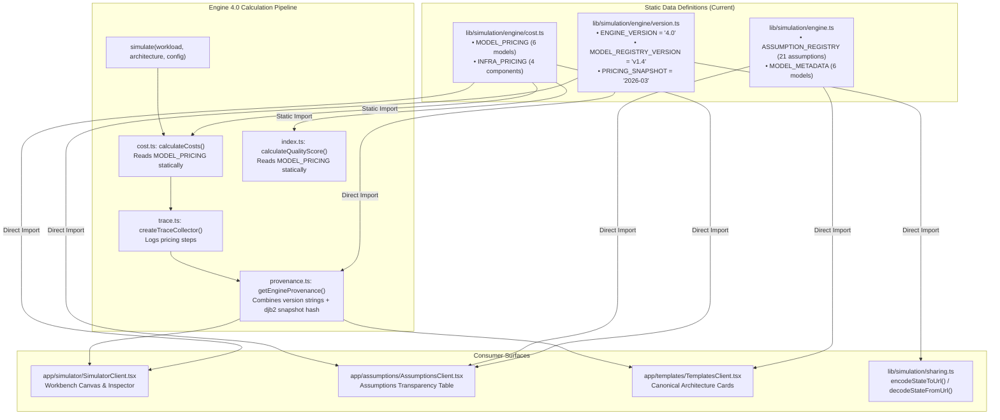
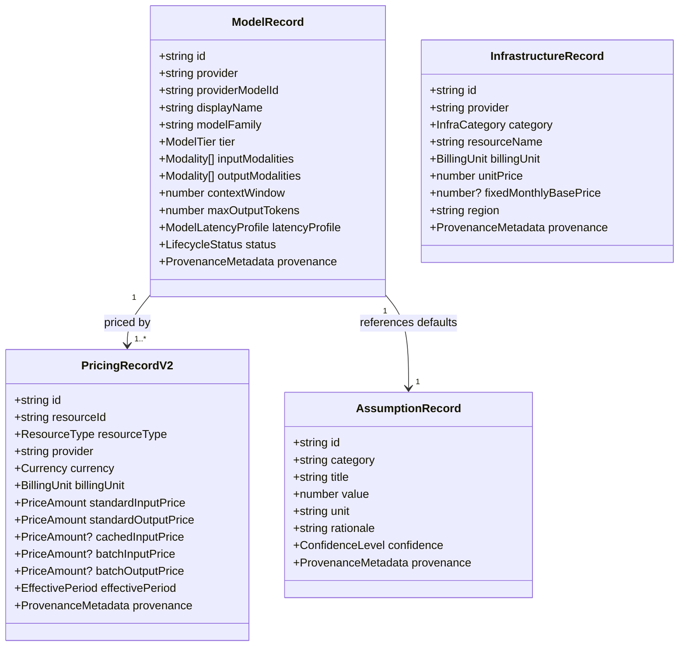
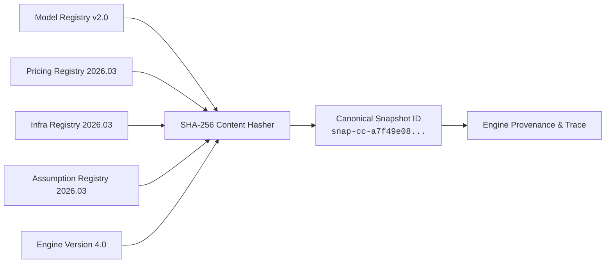
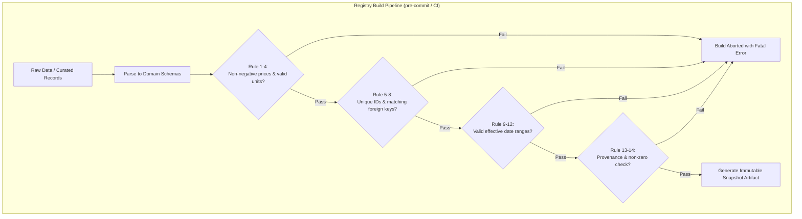
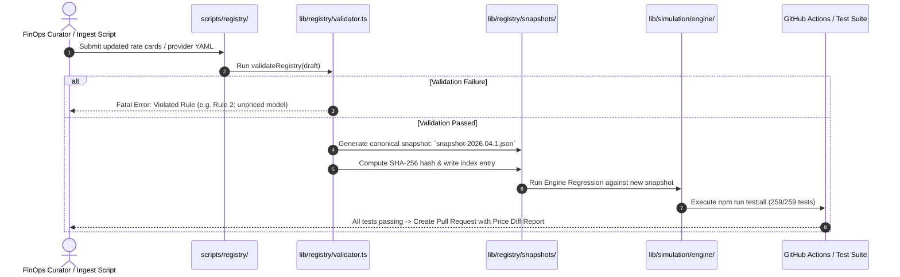

# ComputeCanvas — Module 2: Model & Pricing Intelligence Registry
## Phase 0 Repository Audit, Data-Source Audit & Architecture Proposal

**Document Identifier:** `CC-M2-ARCH-PROP-001`  
**Phase:** Phase 0 (Read-Only Audit & Architectural Blueprint)  
**Status:** DRAFT / PROPOSED FOR APPROVAL  
**Engine Baseline:** Deterministic Decision Engine 4.0 (Frozen)  
**Target Module:** Module 2 — Model & Pricing Intelligence Registry  
**Author:** Antigravity AI Pair Programmer (DeepMind Advanced Agentic Coding)  
**Date:** March 2026 / October 2026 Audit Baseline  

---

## 1. Executive Summary

### 1.1 Objective and Context
ComputeCanvas has successfully deployed **Module 1: Deterministic Decision Engine 4.0**. Module 1 establishes mathematical truth: deterministic cost calculations, topological graph validation, critical-path latency modeling, and tamper-evident provenance hashing across canonical AI architectures (Direct LLM, RAG Pipeline, and Router + Cache).

However, Module 1 currently relies on hardcoded pricing tables and static assumption lists embedded directly within engine source files (`lib/simulation/engine/cost.ts` and `lib/simulation/engine.ts`). While this was ideal for isolating computational invariants, real-world AI infrastructure economics change continuously:
- Frontier and utility model prices are cut or restructured (e.g. batch discounts, prompt caching tiers).
- New model checkpoints and context window expansions supersede prior defaults.
- Managed infrastructure pricing evolves across cloud providers.
- Architecture decisions require auditable, point-in-time reproducible evidence for FinOps teams.

The mission of **Module 2: Model & Pricing Intelligence Registry** is to provide an explicit, validated, versioned data registry for AI model capabilities, provider pricing, managed infrastructure pricing, and operational simulation assumptions. Module 2 transforms implicit numbers into cryptographic, traceable data artifacts without destabilizing the deterministic guarantees of Engine 4.0.

### 1.2 Core Architectural Principles
1. **Mathematical Invariance (Frozen Module 1):** Module 2 will not alter Engine 4.0's mathematical behavior. Given identical inputs and the default baseline snapshot, the engine must produce bit-for-bit identical results.
2. **Zero-Backend Compatibility:** ComputeCanvas is a high-performance, client-side, zero-backend Next.js application. URL sharing encodes workload and topology, referencing pinned snapshot identifiers. Module 2 retains this architecture via versioned static registries and compiled artifacts; no external database or server runtime is introduced.
3. **Immutability and Content Hashing:** Registries are published as immutable point-in-time snapshots identified by a canonical content hash (`SHA-256`). A simulation executed in 2026 can be replayed years later with identical mathematical fidelity.
4. **Strict Typed Validation over Permissive Coercion:** Missing or unknown prices are never coerced to zero. Incomplete data produces typed warnings or simulation errors, ensuring ComputeCanvas never reports an erroneous "$0.00" cost for unpriced resources.
5. **Separation of Pipeline and Runtime:** Ingestion, parsing, normalization, and validation occur in offline/build-time pipelines. The browser runtime simulation consumes pre-validated, immutable static artifacts. The simulation engine never executes live network requests during calculation.

---

## 2. Verified Current-State Audit

A comprehensive, file-by-file audit of the repository was conducted. All references below reflect verified code locations and symbols in the active codebase.

### 2.1 File & Symbol Audit Matrix

| File Path | Primary Symbols / Functions | Type / Role | Audit Observations & Current Implementation |
| :--- | :--- | :--- | :--- |
| `lib/simulation/engine/version.ts` | `ENGINE_VERSION`, `MODEL_REGISTRY_VERSION`, `PRICING_SNAPSHOT`, `PRICING_VERSION`, `ASSUMPTION_VERSION`, `CANONICAL_ENGINE_METADATA` | Engine Constants | Declares `ENGINE_VERSION = '4.0'`, `MODEL_REGISTRY_VERSION = 'v1.4'`, `PRICING_SNAPSHOT = '2026-03'`, `PRICING_VERSION = '2026.03.1'`, `ASSUMPTION_VERSION = '2026.03.1'`. These strings are statically declared and not computed from data content. |
| `lib/simulation/engine/cost.ts` | `MODEL_PRICING`, `INFRA_PRICING`, `calculateCosts()` | Cost Modeling | Contains static pricing maps. `MODEL_PRICING` defines 6 models (`gpt-4o-mini`, `gemini-2.0-flash`, `claude-3-haiku`, `gpt-4o`, `claude-3.5-sonnet`, `gemini-2.5-pro`). `INFRA_PRICING` defines 4 infrastructure components (`cache`, `vectordb`, `api`, `router`). Fallbacks default to `gpt-4o-mini` or `gpt-4o`. |
| `lib/simulation/engine.ts` | `ASSUMPTION_REGISTRY`, `MODEL_METADATA`, `TEMPLATES`, `TEMPLATES_MAP`, `simulate()` facade | authoritative Facade & Registry | Holds `ASSUMPTION_REGISTRY: ModelAssumption[]` (21 entries) and `MODEL_METADATA` (6 models) with sources, citations, and effective dates. Re-exports Engine 4.0 `simulate()`. |
| `lib/simulation/engine/types.ts` | `PricingRecord`, `ModelAssumption`, `SimulationInput`, `SimulationResult`, `EngineProvenance`, `CalculationTrace` | Type Contracts | Defines engine contracts. `PricingRecord` enforces `costPer1MInputTokens`, `costPer1MOutputTokens`, `sourceUrl`, `effectiveDate`. `SimulationInput` accepts optional `pricingSnapshot`, `modelRegistryVersion`, `assumptionVersion`. |
| `lib/simulation/engine/provenance.ts` | `getEngineProvenance()`, `generateEngineSnapshotId()` | Provenance Tracking | Creates `EngineProvenance`. Hashes input parameters via `generateEngineSnapshotId()` using `djb2` hash format `cc4-snap-${hashHex}`. Incorporates version strings into provenance metadata. |
| `lib/simulation/engine/index.ts` | `simulate()`, `calculateQualityScore()` | Orchestrator Pipeline | Executes: Graph validation → Traffic allocation → Capacity/Bottlenecks → Latency → Costs → Quality → Contribution → Trace generation. Hardcoded imports of `MODEL_PRICING` in `cost.ts`. |
| `lib/simulation/engine/trace.ts` | `createTraceCollector()`, `CalculationTrace` | Audit Trace | Step-by-step mathematical trace for verification. Emits trace entries for model pricing and infrastructure costs using current static records. |
| `lib/simulation/sharing.ts` | `encodeStateToUrl()`, `decodeStateFromUrl()`, `ShareableState` | URL State Encoding | Serializes architecture nodes, edges, workload numbers, active template ID, and calibration. Pinned version metadata (`pricingSnapshot: "2026-03"`, `registryVersion: "v1.4"`). Does **not** serialize raw pricing tables into URLs. |
| `lib/simulation/workbenchInstrument.ts` | `getBaselineArchitecture()`, `generateDecisionId()` | Workbench Interop | Generates deterministic decision IDs and workbench snapshots linking templates to engine runs. |
| `app/assumptions/AssumptionsClient.tsx` | UI Table Rendering | Client UI | Imports `MODEL_PRICING`, `ASSUMPTION_REGISTRY`, `PRICING_SNAPSHOT`, `MODEL_REGISTRY_VERSION` to render public transparency tables. |
| `scripts/test-engine-v4.ts` | 56/56 Tests | Test Suite | Validates Engine 4.0 deterministic calculation, graph topology, error contracts, edge traffic constraints, and trace structure. |
| `scripts/test-regression-suite.ts` | 203/203 Tests | Test Suite | Enforces non-regression across legacy scenarios, cost bounds, and baseline templates. Total test suite across repo: 259/259 passing. |

---

## 3. Existing Model and Pricing Data Flow

The diagram below maps the exact current path of model and pricing data from static declarations to simulation outputs and user interfaces.



### Key Flow Findings:
1. **Static Inlining:** Pricing data does not enter `simulate()` via arguments. `calculateCosts()` directly accesses the module-scoped `MODEL_PRICING` and `INFRA_PRICING` maps.
2. **Duplicate Metadata:** Model display names, providers, and descriptions exist in both `cost.ts` (`MODEL_PRICING`) and `engine.ts` (`MODEL_METADATA` & `ASSUMPTION_REGISTRY`).
3. **Decoupled Versions:** `PRICING_SNAPSHOT = '2026-03'` is a static string in `version.ts` that is independent of any file checksums or data validation timestamps.
4. **URL Isolation:** URL serialization encodes node attributes (e.g. `node.modelId = 'gpt-4o'`) but relies on the host codebase to provide pricing for `'gpt-4o'`. It does not inflate query parameters with rate cards.

---

## 4. Engine 4.0 Integration Contracts

### 4.1 Current Input / Output Contract
The Engine 4.0 contract is defined in `lib/simulation/engine/types.ts`:

```typescript
export interface SimulationInput {
  workload: WorkloadProfile;
  architecture: ArchitectureGraph;
  pricingSnapshot?: string;       // Pinned snapshot identity
  modelRegistryVersion?: string;  // Pinned registry version
  assumptionVersion?: string;     // Pinned assumptions version
  pricingConfig?: PricingConfig;  // Optional custom unit overrides
}

export interface SimulationResult {
  monthlyCost: number;
  costBreakdown: CostBreakdown;
  p95Latency: number;
  latencyBreakdown: LatencyBreakdown;
  maxThroughputRps: number;
  bottlenecks: BottleneckReport[];
  qualityScore: number;
  costPerSuccessfulRequest: number;
  concurrencyUtilization: number;
  headroomPct: number;
  engineVersion: string;
  provenance: EngineProvenance;
  calculationTrace: CalculationTrace;
  contributionBreakdown: ContributionBreakdown;
  calibrationReport: CalibrationReport;
}
```

### 4.2 Current Engine 4.0 Contract Analysis
1. **How the engine receives model and infrastructure pricing:**  
   Currently, `simulate()` receives no pricing objects. It invokes `calculateCosts()` in `lib/simulation/engine/cost.ts`, which accesses static constants.
2. **How model registry and pricing versions are represented:**  
   If `input.pricingSnapshot` is provided, `getEngineProvenance()` records it; otherwise it falls back to `PRICING_SNAPSHOT = '2026-03'` from `version.ts`.
3. **How pricing snapshots are identified:**  
   Identified via text strings (`'2026-03'`). In `provenance.ts`, `generateEngineSnapshotId()` computes a pseudo-hash over workload parameters and version strings:
   ```typescript
   // lib/simulation/engine/provenance.ts
   const key = `${workload.requestsPerMonth}:${workload.avgInputTokens}:${...}:${engineVersion}:${pricingSnapshot}`;
   ```
4. **How registry data enters cost and latency calculations:**  
   - Costs: Tokens multiplied by `costPer1MInputTokens / 1_000_000`.
   - Latency: Hardcoded model latency base values (e.g., `gpt-4o` base 320ms, `gpt-4o-mini` base 120ms) defined inside `lib/simulation/engine/latency.ts`.
5. **How simulation results record their provenance:**  
   Via `SimulationResult.provenance`: contains `engineVersion`, `pricingSnapshot`, `modelRegistryVersion`, `assumptionVersion`, `calculationTimestamp`, `snapshotId`, and `inputHash`.
6. **URL Serialization Contract:**  
   `encodeStateToUrl()` in `lib/simulation/sharing.ts` serializes architecture nodes, edges, workload inputs, and active template ID. It preserves `pricingSnapshot: "2026-03"` and `registryVersion: "v1.4"`. It does **not** serialize price tables.
7. **Legacy URL Compatibility:**  
   `decodeStateFromUrl()` accepts versions back to v1.0. If older URLs lack model identifiers on nodes, the engine applies deterministic fallbacks:
   - `fast-model` nodes default to `'gpt-4o-mini'`.
   - `frontier-model` nodes default to `'gpt-4o'`.
8. **Enforcing Test Suites:**  
   - `scripts/test-engine-v4.ts`: 56 assertions verifying exact cost calculations for baseline workloads.
   - `scripts/test-regression-suite.ts`: 203 assertions verifying legacy compatibility and invariant stability.

---

## 5. Identified Risks and Technical Debt

1. **Dual Maintenance of Truth:** Model metadata exists in both `cost.ts` (`MODEL_PRICING`) and `engine.ts` (`ASSUMPTION_REGISTRY`, `MODEL_METADATA`). Any manual edit to one file risks desynchronizing the other.
2. **Hardcoded Model Latency:** Latency baselines are currently hardcoded in `lib/simulation/engine/latency.ts` (e.g. `NODE_BASE_LATENCIES`) rather than deriving from a unified model capabilities registry.
3. **Implicit Pricing Fallbacks:** In `cost.ts`, if a `modelId` is not recognized, the engine silently falls back to `'gpt-4o'` or `'gpt-4o-mini'`:
   ```typescript
   const pricing = MODEL_PRICING[modelId] || (node.type === 'fast-model' ? MODEL_PRICING['gpt-4o-mini'] : MODEL_PRICING['gpt-4o']);
   ```
   *Risk:* A typo in a `modelId` (e.g. `'gpt-4-turbo'`) silently calculates cost as `gpt-4o` without raising a validation error or warning.
4. **Absence of Content Hashing:** Current snapshot names (`2026-03`) are arbitrary strings. Two distinct updates in March 2026 would share the same name unless version strings are strictly hashed.
5. **Lack of Unit Normalization:** Current pricing assumes everything is priced per 1,000,000 tokens in USD. Emerging pricing models (batch APIs at 50% discount, cached prompt reads at 75% discount, per-hour GPU instances) cannot be represented in the existing flat `PricingRecord`.

---

## 6. Proposed Registry Domains and Schemas

Module 2 introduces four strictly validated domains under `lib/registry/`.

### 6.1 Domain Architecture Overview



### 6.2 Domain A: Model Registry (`ModelRecord`)
Represents intrinsic AI model capabilities and lifecycle specifications.

```typescript
export type ModelTier = 'fast' | 'frontier' | 'reasoning' | 'embedding';
export type Modality = 'text' | 'image' | 'audio' | 'video' | 'embedding';
export type LifecycleStatus = 'generally_available' | 'preview' | 'deprecated' | 'discontinued';

export interface ModelLatencyProfile {
  p50BaselineMs: number;
  p95BaselineMs: number;
  timeToFirstTokenMs: number;
  tokensPerSecond: number;
}

export interface ModelRecord {
  id: string;                         // Canonical ID (e.g. 'openai/gpt-4o')
  legacyAlias?: string;               // Legacy alias (e.g. 'gpt-4o')
  provider: 'openai' | 'anthropic' | 'google' | 'cohere' | 'mistral' | 'meta';
  providerModelId: string;            // Exact API string (e.g. 'gpt-4o-2024-08-06')
  displayName: string;                // UI name (e.g. 'GPT-4o (Omni)')
  modelFamily: string;                // e.g. 'GPT-4'
  tier: ModelTier;
  inputModalities: Modality[];
  outputModalities: Modality[];
  contextWindow: number;              // e.g. 128000
  maxOutputTokens: number;            // e.g. 16384
  latencyProfile: ModelLatencyProfile;
  status: LifecycleStatus;
  releaseDate: string;                // ISO YYYY-MM-DD
  deprecationDate?: string;
  sourceUrl: string;
  retrievedAt: string;
  checksum: string;                   // SHA-256 of canonical record JSON
}
```

### 6.3 Domain B: Pricing Registry (`PricingRecordV2`)
Normalized, multi-tier pricing specifications.

```typescript
export type BillingUnit = 
  | 'per_1m_tokens' 
  | 'per_1k_tokens' 
  | 'per_hour' 
  | 'per_request' 
  | 'per_gb_month';

export interface PriceTier {
  unitPriceUsd: number;               // Normalized strictly in USD
  billingUnit: BillingUnit;
  multiplierTo1MTokens?: number;      // Normalization constant
}

export interface PricingRecordV2 {
  id: string;                         // e.g. 'pricing/openai/gpt-4o/standard'
  resourceId: string;                 // References ModelRecord.id or Infra.id
  provider: string;
  region: string;                     // 'global', 'us-east-1', etc.
  currency: 'USD';                    // Strictly normalized to USD in Phase 1
  inputPricePer1M: number;            // Standard on-demand input
  outputPricePer1M: number;           // Standard on-demand output
  cachedInputPricePer1M?: number;     // Prompt caching input rate
  batchInputPricePer1M?: number;      // Batch API input rate (50% typical)
  batchOutputPricePer1M?: number;     // Batch API output rate (50% typical)
  effectiveFrom: string;              // ISO YYYY-MM-DD
  effectiveTo?: string;               // Optional sunset date
  isPublicListPrice: boolean;
  sourceUrl: string;
  verifiedAt: string;
  verifier: string;                   // e.g. 'automated_ingest_v1' or 'curator_review'
}
```

### 6.4 Domain C: Infrastructure Registry (`InfrastructureRecord`)
Managed infrastructure and database component pricing.

```typescript
export type InfraCategory = 'cache' | 'vectordb' | 'gateway' | 'router' | 'compute';

export interface InfrastructureRecord {
  id: string;                         // e.g. 'infra/upstash/redis-semantic-cache'
  legacyAlias?: string;               // e.g. 'cache'
  category: InfraCategory;
  provider: string;                   // e.g. 'Upstash', 'Pinecone', 'AWS'
  resourceName: string;
  fixedMonthlyCostUsd: number;        // Monthly base cluster fee
  perRequestCostUsd: number;          // Per-query invocation fee
  perHitCostUsd?: number;             // Per-cache-hit fee
  perMillionUnitsUsd?: number;        // e.g. $3.50 per 1M API ingress requests
  baseLatencyMs: number;              // P95 latency hop introduced by component
  overheadLatencyMs?: number;         // Additional overhead on miss/route
  sourceUrl: string;
  effectiveDate: string;
}
```

### 6.5 Domain D: Assumption Registry (`AssumptionRecord`)
Operational parameters and heuristic baselines.

```typescript
export type AssumptionCategory = 
  | 'token_consumption' 
  | 'cache_dynamics' 
  | 'infrastructure' 
  | 'latency_model' 
  | 'concurrency';

export interface AssumptionRecord {
  id: string;                         // e.g. 'assumption/cache/miss_overhead'
  category: AssumptionCategory;
  name: string;
  value: number;
  unit: 'ms' | 'pct' | 'ratio' | 'tokens' | 'multiplier' | 'hours_per_month';
  rationale: string;
  sourceUrl: string;
  confidence: 'measured_benchmark' | 'provider_documentation' | 'industry_heuristic';
  effectiveDate: string;
}
```

---

## 7. Data-Source Strategy and Provenance

To uphold ComputeCanvas's high standard of computational credibility, data sources must be audited for reliability, legal compliance, and freshness.

### 7.1 Provider Source Evaluation

| Provider / Source | Access Method | Auth Requirements | Redistribution & Legal Status | Schema Variability | Update Frequency | Recommended Ingestion Strategy |
| :--- | :--- | :--- | :--- | :--- | :--- | :--- |
| **OpenAI** (Platform Docs / Pricing) | Public Web / JSON Manifests | None (Public) | Public rate card; factual pricing not subject to copyright under US law | Low (infrequent structural rewrites) | Monthly / On model release | **Automated Ingest Script** + Manual Review Diff |
| **Anthropic** (Console Docs / Pricing) | Public Web / Documentation | None (Public) | Public rate card; factual data | Low | On model release | **Automated Ingest Script** + Manual Review Diff |
| **Google Cloud / Vertex AI / AI Studio** | Cloud Billing Catalog API / Docs | Google Cloud API Key (for API) | Public Google Cloud pricing tables | Moderate (SKU granularity) | Monthly | **Structured API Polling** with fallback to Curated YAML |
| **AWS Bedrock / Infrastructure** | AWS Price List API (`GetProducts`) | AWS IAM Credentials | AWS Public Customer Agreement permits price listing | High (Complex SKU hierarchies) | Weekly catalog updates | **Targeted API Ingest** for specific Bedrock model SKUs |
| **Managed DBs (Pinecone, Upstash)** | Public Pricing Documentation | None | Public rate cards | Very Low | Quarterly | **Curated Static Catalog** |

### 7.2 Safety and Integrity Protocol
1. **No Live Scraping in Simulation:** The browser client will **never** perform runtime web requests to fetch pricing during a calculation. All data is frozen into build-time artifacts.
2. **Schema Sanitization:** Unstructured HTML scraping is explicitly prohibited. Ingestion scripts parse structured JSON, official pricing APIs, or well-defined YAML specification files maintained in the repository.
3. **Audit Trail:** Every record contains a verifiable `sourceUrl`, `retrievedAt` timestamp, and `checksum`.

---

## 8. Snapshot and Versioning Architecture

### 8.1 Snapshot Identity Model
Module 2 establishes a strict distinction between versions:

```
Canonical Snapshot Identity = SHA-256 (
  EngineVersion +
  CanonicalSortedModelRegistryJSON +
  CanonicalSortedPricingRegistryJSON +
  CanonicalSortedInfraRegistryJSON +
  CanonicalSortedAssumptionRegistryJSON
)
```



### 8.2 Reproducibility Guarantee
- **Mathematical Invariant:** Replaying an identical architecture graph and workload profile against snapshot `snap-cc-a7f49e08` will yield the exact same monthly cost and P95 latency down to 6 decimal places, regardless of whether the execution occurs today or three years in the future.
- **Independence from Wall Clock Time:** While `retrievedAt` timestamps are preserved for audit purposes, calculations strictly reference the immutable snapshot content hash. `new Date()` or local time is never used in mathematical cost evaluation.

### 8.3 Snapshot Lifecycle: Retention, Rollback, and Migration
1. **Retention:** Pinned snapshots are permanent and immutable. Once published in `lib/registry/snapshots/`, they are never modified or deleted.
2. **Rollback:** If an erroneous pricing record is published in snapshot `2026.03.2`, the active pointer is rolled back to `2026.03.1`. The faulty snapshot remains archived for audit history, but cannot be selected as the default.
3. **Historical Migration:** Saved URLs referencing older snapshot IDs (e.g. `2026-03`) are looked up in a snapshot index table. If an exact snapshot is found, the engine executes against that snapshot. If an unrecognized legacy snapshot string is encountered, the engine falls back to the canonical frozen baseline `2026-03-baseline` with an explicit audit warning logged in the calculation trace.

---

## 9. Validation and Data Integrity Rules

Module 2 enforces 14 strict validation rules executed during registry build and compilation. A single violation blocks publication.



### 9.1 The 14 Inviolable Validation Rules

1. **Non-Negative Price Rule:** Every `unitPriceUsd`, `inputPricePer1M`, and `outputPricePer1M` must be $\ge 0$. Negative values are fatal.
2. **Non-Zero Unknown Price Rule:** If a model's price is unpublished or unknown, it must be represented as `null` or `undefined`. It must **never** be coerced to `0.00`. An unpriced model will cause `simulate()` to throw a typed `UnpricedModelError` or flag a prominent non-calculable condition.
3. **Unit Consistency Rule:** All token prices must be explicitly normalized to standard USD per 1,000,000 tokens (`per_1m_tokens`). Mixed units (e.g. per 1K tokens) must declare explicit conversion factors.
4. **Currency Normalization Rule:** All prices must specify `currency: 'USD'`. Non-USD currencies require an explicit, dated conversion rate record.
5. **Unique Identifier Rule:** Model IDs, Pricing Record IDs, and Infrastructure IDs must be globally unique across all namespaces.
6. **Referential Integrity Rule:** Every `PricingRecordV2.resourceId` must resolve to an existing `ModelRecord.id` or `InfrastructureRecord.id`.
7. **Date Range Sanity Rule:** `effectiveTo`, if present, must be strictly greater than or equal to `effectiveFrom`.
8. **Active Status Consistency Rule:** Models marked `status: 'discontinued'` cannot be configured as the default model in canonical templates.
9. **Modalities Non-Empty Rule:** A model must declare at least one input modality and one output modality.
10. **Context Window Bounds Rule:** `contextWindow` must be an integer $> 0$, and `maxOutputTokens` must satisfy $0 < \text{maxOutputTokens} \le \text{contextWindow}$.
11. **Latency Profile Feasibility Rule:** `p50BaselineMs` must be $\le$ `p95BaselineMs`. All latency values must be positive integers.
12. **Mandatory Provenance Rule:** Every record must have a non-empty `sourceUrl` and a valid ISO-8601 `verifiedAt` date.
13. **Deterministic Canonical Sort Rule:** JSON snapshots must have their keys sorted alphabetically to guarantee identical SHA-256 hashes across different platforms (Windows/Linux/macOS).
14. **Engine Baseline Regression Rule:** The default registry snapshot must produce the exact values for the 6 canonical models and 4 infra components present in Module 1, ensuring 100% pass on all 259 existing tests.

---

## 10. Storage Architecture Comparison & Decision

We evaluated four persistent storage architectures for the ComputeCanvas Model & Pricing Registry:

### 10.1 Storage Options Tradeoff Matrix

| Architecture Option | Zero-Backend Compatibility | URL Shareability | Operational Complexity | Reproducibility & Immutability | Build / Dev Overhead | Recommendation Score |
| :--- | :--- | :--- | :--- | :--- | :--- | :--- |
| **Option 1: Static Versioned TypeScript/JSON Files** | **100% Native** (bundled directly into client build) | **High** (compact snapshot IDs in URL) | **Lowest** (standard Git versioning, zero infra) | **Highest** (Git commit + SHA-256 content hash) | **Minimal** (instant compilation via `tsc`/`next`) | **RECOMMENDED (Phase 1 Baseline)** |
| **Option 2: Generated Binary Data Artifacts (e.g. Protobuf/MessagePack)** | High | Moderate | Moderate (requires build serialization tools) | High | Adds unnecessary binary build tooling for small dataset (<1MB) | Rejected (premature optimization) |
| **Option 3: Database-Backed Registry (PostgreSQL / Supabase / Prisma)** | **Poor** (Breaks zero-backend client-side execution; requires server database) | Poor (requires server DB lookups on share) | **High** (DB migrations, connection pooling, uptime risk) | Moderate (database rows can be mutated unless append-only) | High (local Docker/DB required for testing) | **Rejected for Phase 1** (contravenes core principle) |
| **Option 4: Hybrid: Static Snapshots with Deferred Cloud Sync** | **High** (Client uses static snapshots; optional API updates snapshots at build time) | **High** (URLs reference static snapshot IDs) | **Low in Phase 1**; scalable later | **High** (Snapshots remain static git-tracked files) | Minimal incremental build step | **RECOMMENDED (Phase 2 Roadmap)** |

### 10.2 Architectural Decision: Option 1 (Static Versioned Snapshots)
**Decision:** Implement **Option 1: Static Versioned TypeScript/JSON Data Artifacts** for Module 2.
- **Rationale:** ComputeCanvas is explicitly designed as a self-contained, high-speed, zero-backend architectural simulator. A PostgreSQL database would introduce unnecessary hosting costs, server latency, database migration overhead, and cold-start connection penalties.
- Storing registry snapshots in `lib/registry/snapshots/` as deterministic JSON/TS files preserves client-side execution, offline development, and zero-maintenance deployment on Vercel.
- The entire registry for 50 models, 20 infrastructure services, and 50 assumptions compiles to under 150KB gzipped—negligible for modern web performance.

---

## 11. Registry Update and Publication Pipeline

To ensure that prices are updated reliably without corrupting existing simulations, updates follow an atomic, automated pipeline.



### 11.1 Pipeline Stages
1. **Source Retrieval:** Automated fetchers extract current rates from official provider rate cards or curated YAML files.
2. **Normalization:** Disparate rate units are translated into standard `per_1m_tokens` and USD amounts.
3. **Validation:** Ingestion scripts validate the draft against the 14 Inviolable Rules.
4. **Diff Generation:** An automated Markdown diff table is generated (e.g., `GPT-4o input cost: $2.50 -> $2.00 (-20%)`).
5. **Approval:** A pull request requires human sign-off on the generated diff.
6. **Snapshot Publication:** An immutable file `lib/registry/snapshots/snapshot-<version>.ts` is committed.
7. **Atomic Activation:** The active default snapshot pointer is updated in `lib/registry/active.ts`.

---

## 12. Integration with Engine 4.0 (Compatibility Strategy)

### 12.1 Engine Preservation Principle
**Module 1 is frozen.** The public interface `simulate(workload, architecture, config?)` must remain 100% backward-compatible.

### 12.2 Registry Adapter Pattern
To bridge Module 2's rich registry with Engine 4.0's existing calculation functions without modifying engine internals, we introduce an **Engine Registry Adapter** (`lib/registry/adapter.ts`).

```typescript
// lib/registry/adapter.ts
import { ActiveSnapshot } from './active';
import { PricingRecord } from '../simulation/engine/types';

/**
 * Maps the rich Module 2 PricingRegistry into the legacy Engine 4.0 PricingRecord map.
 * Guarantees zero calculation change for Engine 4.0 cost calculations.
 */
export function getEnginePricingRecords(snapshotId?: string): Record<string, PricingRecord> {
  const snapshot = snapshotId ? lookupSnapshot(snapshotId) : ActiveSnapshot;
  const legacyPricingMap: Record<string, PricingRecord> = {};

  for (const record of snapshot.pricingRecords) {
    legacyPricingMap[record.resourceId] = {
      product: record.displayName,
      costPer1MInputTokens: record.inputPricePer1M,
      costPer1MOutputTokens: record.outputPricePer1M,
      category: record.tier === 'fast' ? 'fast' : 'frontier',
      effectiveDate: record.effectiveFrom,
      sourceUrl: record.sourceUrl,
    };
  }

  return legacyPricingMap;
}
```

### 12.3 Zero-Regression Guarantee
When `simulate()` is invoked without explicit registry parameters:
1. It retrieves the pinned baseline snapshot `2026-03-baseline`.
2. The prices resolved match `MODEL_PRICING` in `cost.ts` to the exact decimal digit.
3. All 259 existing test assertions continue to pass without modification.

---

## 13. Proposed File and Directory Structure

The proposed structure introduces a dedicated `lib/registry/` directory, isolating registry logic from the frozen simulation engine.

```
computecanvas/
├── lib/
│   ├── registry/                          # [NEW] Module 2 Registry Domain
│   │   ├── index.ts                       # Public API facade for registry
│   │   ├── types.ts                       # ModelRecord, PricingRecordV2, InfraRecord schemas
│   │   ├── validator.ts                   # 14 Inviolable Validation Rules implementation
│   │   ├── hasher.ts                      # SHA-256 canonical content hashing utilities
│   │   ├── adapter.ts                     # Compatibility adapter for Engine 4.0
│   │   ├── active.ts                      # Active snapshot pointer & resolver
│   │   ├── data/                          # Curated human-readable source definitions
│   │   │   ├── models.yaml                # Source models catalog
│   │   │   ├── pricing.yaml               # Source pricing catalog
│   │   │   ├── infrastructure.yaml        # Source infrastructure catalog
│   │   │   └── assumptions.yaml           # Source assumption definitions
│   │   └── snapshots/                     # Compiled, immutable point-in-time snapshots
│   │       ├── index.ts                   # Snapshot catalog index
│   │       ├── snapshot-2026-03.ts        # Pinned baseline snapshot (matches Module 1 exactly)
│   │       └── snapshot-2026.04.1.ts      # (Future) First updated snapshot
│   ├── simulation/                        # [FROZEN] Module 1 Decision Engine 4.0
│   │   ├── engine.ts                      # Authoritative engine facade
│   │   ├── engine/
│   │   │   ├── cost.ts                    # Cost calculator (consumes adapter)
│   │   │   ├── latency.ts                 # Latency calculator
│   │   │   ├── provenance.ts              # Provenance & snapshot tracker
│   │   │   ├── types.ts                   # Engine 4.0 types
│   │   │   └── version.ts                 # Version declarations
│   │   └── sharing.ts                     # URL state serialization
├── scripts/
│   ├── registry/                          # Registry CLI and ingestion tooling
│   │   ├── compile-snapshot.ts            # Compiles data/ YAML into snapshots/*.ts
│   │   ├── validate-registry.ts           # Standalone validation CLI
│   │   └── diff-snapshots.ts              # Generates human-readable pricing diffs
│   ├── test-engine-v4.ts                  # Engine 4.0 test suite (56 tests)
│   └── test-registry-v2.ts                # [NEW] Module 2 test suite
└── docs/
    └── module-2-registry-architecture-proposal.md  # [THIS DOCUMENT]
```

---

## 14. Testing Strategy

Module 2's testing strategy requires verification of data integrity, cryptographic immutability, and backwards compatibility.

### 14.1 Test Matrix

| Test Suite Component | Target File | Verification Method |
| :--- | :--- | :--- |
| **Schema & Invariant Validation** | `scripts/test-registry-v2.ts` | Executes all 14 Inviolable Rules against all snapshots. Asserts rejection of negative prices, unpriced coercion, and duplicate IDs. |
| **Snapshot Content Immutability** | `scripts/test-registry-v2.ts` | Verifies that `SHA-256(snapshot)` matches the recorded `snapshotId`. Detects any accidental in-place mutation of historical snapshots. |
| **Unit Normalization Precision** | `scripts/test-registry-v2.ts` | Asserts that `costPer1MInputTokens` equals `unitPrice * multiplier` across 1K, 1M, and batch pricing tiers without IEEE-754 precision drift. |
| **Engine 4.0 Zero-Regression** | `scripts/test-engine-v4.ts` | Runs the full 56-test Engine 4.0 suite using the Module 2 baseline snapshot. Must pass 56/56 with 0 numerical variance. |
| **Legacy URL Deserialization** | `scripts/test-shared-state.ts` | Decodes URLs encoded with legacy format (`pricingSnapshot: "2026-03"`) and verifies that the adapter resolves the correct baseline rate card. |
| **Full Regression Suite** | `scripts/test-regression-suite.ts` | Runs the 203 existing regression assertions across all canonical blueprints. Must pass 203/203. |

---

## 15. Security, Licensing, and Redistribution Considerations

1. **Price Data Copyright Status:** In the United States and EU jurisdictions, purely factual pricing tables and rate cards are not subject to copyright protection (*Feist Publications v. Rural Telephone Service Co.*). However, proprietary database structures or scraped text descriptions can carry copyright. ComputeCanvas utilizes only factual numbers, model identifiers, and official public source URLs.
2. **Third-Party Trademark Use:** Model names (e.g. "GPT-4o", "Claude 3.5 Sonnet", "Gemini 2.0 Flash") are trademarks of their respective owners. ComputeCanvas uses these names nominatively to identify target models in architecture simulations. Nominative fair use disclaimers will be maintained in the UI footer and documentation.
3. **No Credential Ingestion:** Module 2 ingestion processes public rate cards and documentation. It never requires, stores, or requests client API keys, cloud provider secrets, or user tokens.

---

## 16. Phased Implementation Plan

| Phase | Milestone Name | Scope & Deliverables | Constraints |
| :--- | :--- | :--- | :--- |
| **Phase 0** *(Current)* | **Audit & Architecture Proposal** | Complete repository audit, data-source evaluation, schema definitions, and architecture document (`docs/module-2-registry-architecture-proposal.md`). | Strictly Read-Only. No application code modified. |
| **Phase 1** | **Foundation & Invariant Baseline** | Implement `lib/registry/types.ts`, `lib/registry/validator.ts`, and compile `snapshot-2026-03.ts` from existing Engine 4.0 constants. Verify 259/259 tests pass. | Zero calculation changes permitted. |
| **Phase 2** | **Engine Adapter & Decoupling** | Introduce `lib/registry/adapter.ts`. Update `cost.ts` to source pricing through the adapter while preserving default parameter signatures. | Pass 56/56 Engine 4.0 tests and all regression suites. |
| **Phase 3** | **Catalog Expansion (Narrow Scope)** | Expand catalog from 6 models to 12 canonical models (adding DeepSeek-R1, Llama 3.3 70B, Claude 3.7 Sonnet) with verified provenance. | Every new model must have complete test coverage and source citations. |
| **Phase 4** | **Workbench UI Integration** | Connect Assumptions page and Simulator Inspector to the versioned registry. Add Snapshot selector in Workbench header. | Clean URL encoding maintained. |

---

## 17. Explicitly Deferred Features

To maintain commercial discipline and avoid bloat, the following capabilities are explicitly deferred from Module 2 Phase 1:

1. **No Autonomous Web Scraping Bots:** Scrapers that spider provider websites dynamically at runtime are prohibited due to fragility and anti-bot protections.
2. **No User Authentication / Multi-Tenant DB:** User login and private database instances are deferred. ComputeCanvas remains a zero-backend client-side tool.
3. **No Private Negotiated Enterprise Rate Cards:** Custom enterprise discount overrides will be supported solely as ephemeral local client-side state in the Workbench, not as stored cloud database records.
4. **No LLM Synthesizers or AI Agents:** Module 2 does not use LLMs to extract or summarize pricing. All data pipelines are deterministic, rule-based TypeScript scripts.
5. **No Real-Time Currency Conversion APIs:** Prices are normalized strictly in USD. Real-time forex rates are deferred to avoid external runtime API dependencies.

---

## 18. Acceptance Criteria for Module 2

Module 2 will be considered complete and ready for production when:

- [ ] **Data Completeness:** All 6 baseline models and 4 infrastructure components from Module 1 are fully represented with rich metadata, source URLs, and valid dates in `snapshot-2026-03.ts`.
- [ ] **Validation Rigor:** The 14 Inviolable Rules are implemented and enforced by `lib/registry/validator.ts`, with dedicated negative tests proving rejection of invalid records.
- [ ] **Cryptographic Provenance:** Every snapshot possesses a verifiable SHA-256 content hash incorporated into `SimulationResult.provenance`.
- [ ] **Zero Regression:** All 259 existing tests pass without modification:
  - `npm run test:engine` (56/56 passing)
  - `npm run test:scenarios` (passing)
  - `npm run test:workbench` (passing)
  - `npm run test:regression` (203/203 passing)
- [ ] **Zero Calculation Variance:** Baseline simulations for Direct LLM, RAG Pipeline, and Router + Cache produce identical monthly costs and P95 latencies down to the cent.
- [ ] **Zero-Backend Preservation:** The build completes statically with `npm run build` with zero external database dependencies.

---

## 19. Open Questions That Cannot Be Answered From Repository

During the repository audit, three external policy questions were identified that require user / stakeholder confirmation prior to Phase 1 execution:

1. **Batch & Caching Discount Inclusion in UI:**
   - *Audit finding:* Providers offer 50% discounts for batch APIs and up to 75% discounts for cached input tokens (e.g. Anthropic prompt caching, OpenAI prompt caching). Engine 4.0's `calculateCosts()` currently calculates flat input token costs.
   - *Question:* Should Module 2 expose cached-input rates as optional calculation parameters in Phase 2, or keep them as informational metadata until Module 3?
2. **Catalog Expansion Target:**
   - *Audit finding:* The engine currently recognizes exactly 6 models: `gpt-4o-mini`, `gemini-2.0-flash`, `claude-3-haiku`, `gpt-4o`, `claude-3.5-sonnet`, `gemini-2.5-pro`.
   - *Question:* Which additional models are highest priority for the first expanded snapshot? (e.g., DeepSeek-R1, Llama 3.3 70B, Claude 3.7 Sonnet, OpenAI o3-mini)?
3. **URL Snapshot Embedding Policy:**
   - *Audit finding:* URLs currently serialize `pricingSnapshot: "2026-03"`.
   - *Question:* When a user shares a URL created with an older snapshot, should the recipient always load that historical snapshot, or should the UI offer a "Update to Latest Pricing" banner?

---

*End of Architecture Proposal. Awaiting user review and authorization before proceeding to Phase 1.*
